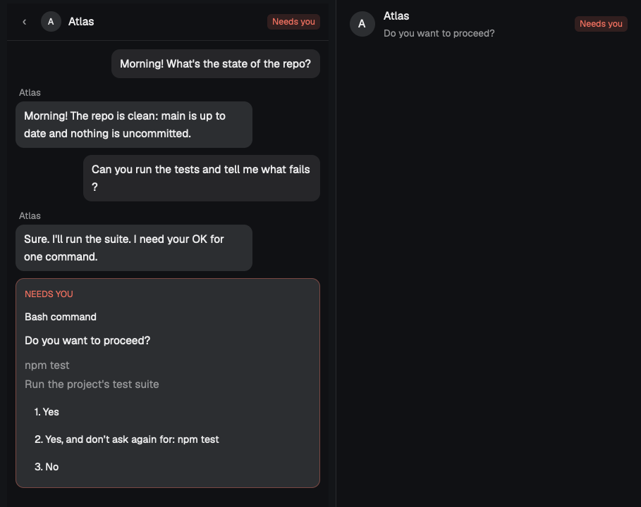

# herdr-bot for Herdr

A chat panel for your coding agents, as a mod for the [Herdr](https://herdr.dev) desktop app. Each agent becomes a "bot" you can message, they can message each other, you see who is working or waiting for you, and you can answer an agent's permission prompt with one click.



*A scripted demo agent in a layout of my own: a chat with an approval card waiting, and the bot list docked beside it.*

## Install

Tell your Herdr agent:

> Add the mod from https://github.com/ldangelo/herdr-bot-mod

or copy `mods/herdr-bot/` to `~/.config/herdr-app/mods/herdr-bot/` yourself, then open it with `herdr-app do mod.open '{"name":"herdr-bot"}'` (or as a tab: `herdr-app do tab.new '{"mod":"herdr-bot"}'`).

The first time, the panel asks before downloading its host program. It is the part that actually starts and talks to your agents, and it is not in this repository.

## What it does on your computer

Read this before you add it. The mod:

- **runs programs**: `test`, `mkdir`, `curl`, `shasum`, `chmod`, `mv`, `rm`, and `hc run`, `hc kill` and `hc rm`;
- **reaches the network**: it fetches a manifest and downloads one file from `github.com/ldangelo/herdr-app-bot` releases, and talks to a local WebSocket on `127.0.0.1`;
- **reads** `<app home>/herdr-bot.json` and `~/.herdr-bot/ws.json` (a token for the local host, readable only by you), and **writes** `~/.herdr-bot/bin/herdr-bot`;
- **downloads and runs an executable** (85–104 MB) that starts coding agents on your behalf.

The download is checked against a SHA-256 in the release manifest. That protects against a damaged download, not a compromised release: you are trusting the [herdr-app-bot](https://github.com/ldangelo/herdr-app-bot) repository. The code is all here to read, and [`RECIPE.md`](RECIPE.md) describes it exactly.

## Settings

`<app home>/herdr-bot.json` (all optional):

```json
{ "home": "/path/for/herdr-bot/files", "hostSource": "https://example.com/releases/host-v1.3.0" }
```

`home` is where the host keeps its files (default `~/.herdr-bot`); `hostSource` is where the host is downloaded from (`https`, or `http` to this computer).

## Platforms

macOS (Apple silicon and Intel) and Linux (x64, arm64). Windows is not supported. Only the Apple-silicon macOS build has been run end to end.

## Where this comes from

This repository is generated from [`ldangelo/herdr-app-bot`](https://github.com/ldangelo/herdr-app-bot) (`mod/`), which also has the host and its releases; open issues there. It builds on [`speardragon/herdr-bot`](https://github.com/speardragon/herdr-bot). MIT licensed.

Uninstall: delete `~/.config/herdr-app/mods/herdr-bot/`, and `~/.herdr-bot/` if you want the host and its chat history gone too.
