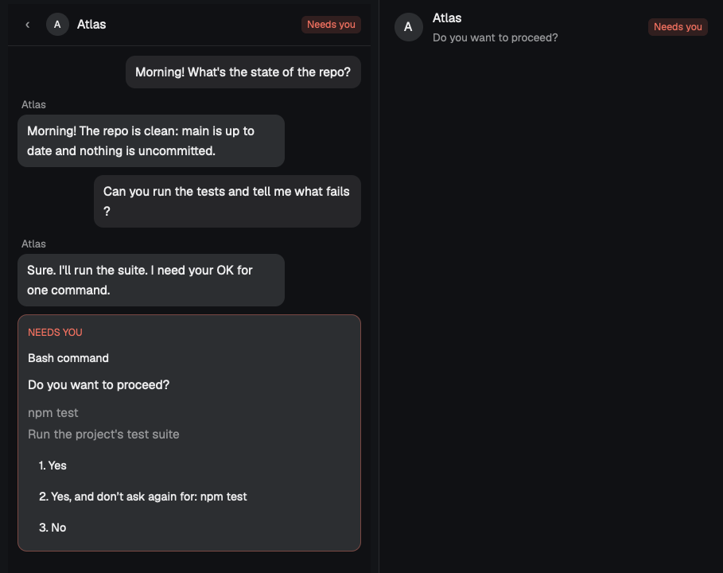

# herdr-bot

A chat panel for your coding agents inside the Herdr window. Each agent (Claude Code, Codex, Grok, Antigravity, OpenCode, or any agent that reports its status) becomes a "bot" you can message. Bots can also message each other. You see who is working, who is waiting for you, and who is idle, and you can answer an agent's permission prompt with one click instead of switching to its terminal.

*The preview shows two copies of the panel in a layout of the person's own, played by a scripted demo agent: on the left one opened on a chat with an approval card waiting, on the right the bot list.*

**This mod runs programs, reaches the network and downloads an executable.** Read *Watch out* before adding it.

## What you see

A panel that docks on the right, 360 px wide (`mod.json`: `place: "right"`, `size: 360`, `focusable: true`). Its background is the theme's `chrome` color, its text `foreground`. It has three screens and a set of centered status messages.

**The bot list.** A 40 px header with a 1 px `border` line under it and 14 px side padding. The title `herdr-bot` is 13 px semibold. On the right, in order: a `+ New` button (24 px tall, 10 px side padding, 6 px radius, `raised` background, 12 px semibold), then, when they apply, a pill `N need you` (18 px tall, 5 px radius, 10.5 px semibold `blocked` text on `blocked` at 15% opacity) and the text `N working` (11 px, `muted`). Under it a scrolling list, 6 px padding and 2 px between rows. Each row is 10 px wide padding by 8 px tall, an 8 px radius, `hover` background on hover, and shows:

- a round avatar, 30 px, `raised` background, the name's first letter uppercased (13 px semibold);
- the bot's name (13 px semibold, `foreground`) over a one-line preview (11.5 px, `muted`, truncated): the last message, else `Room` or the provider name;
- an unread badge when there are unread messages: 18 px pill, `accent` background, `accent_foreground` number (10.5 px semibold);
- a status mark, far right (see *How it behaves*).

Rows are ordered: needs you, working, done, idle, then offline or unknown; within each, most recent first. Chats the host marks hidden are left out. With no bots it says `No bots yet`, `Start an agent, or adopt one that is already running.` and a `New bot` button.

**A chat.** Replaces the list. A 44 px header: a `‹` back button, a 24 px avatar, the bot's name (13 px semibold, truncated) and the same status mark. Below it the transcript scrolls, with 10 px padding and 8 px between messages. Your messages sit on the right (`selected` background), the bot's on the left (`raised` background) with the author's name above them (11 px semibold, `muted`). A bubble is at most 280 px wide, 10 px by 7 px padding, 10 px radius, 13 px text, split into one line per newline. System notices are a single 11.5 px `dim` line. At the bottom, over a 1 px `border` line, a composer with 10 px padding: a multi-line text area (placeholder `Message`, grows from 2 to 8 rows) and a `Send` button (primary: `solid` background and `solid_foreground` text; when the box is empty or sending, `raised` background and `dim` text). An error from sending shows above it in 11.5 px `blocked`.

**An approval card** appears in the transcript where an agent asked for permission: a 1 px border, 10 px radius, 10 px padding, `raised` background. While it is answerable the border is `blocked` at 40% and the first line reads `NEEDS YOU` (10.5 px semibold, `blocked`); afterwards the border is `border` and that line shows the status in capitals (`ANSWERED`, in `dim`). Then the prompt's title (12 px semibold), its question (13 px), its detail lines (13 px, `muted`), and one button per option labelled `1. Yes`, `2. Yes, and don't ask again…`, `3. No`.

**New bot.** A 44 px header with `‹` and `New bot`; a scrolling body with 14 px padding and 14 px between sections; a footer with `Cancel` and a primary `Create` / `Adopt` button. A toggle at the top chooses `Start an agent` or `Adopt a running one`. Starting shows, each under a small uppercase 11 px `dim` heading: **Name** (text field); **Provider** (pills: Claude Code, Codex, Grok CLI, Antigravity CLI, OpenCode); **Model** (a list at most 150 px tall, or a text field when the host has no list); **Reasoning** (pills `low medium high xhigh max`, only for Claude Code, Codex and Grok, `high` selected first); **Folder** (text field and a `Choose…` button for the system folder picker); **Permissions** (`Ask first` or `Auto`). Adopting lists running agents that report a status (name, provider and folder, status at the right) and a Name field.

**Status messages**, centered with 24 px side padding: `Connecting to herdr-bot…`, `Starting the herdr-bot host…`, `Installing the herdr-bot host…`, `Lost the host. Reconnecting…`, and two that ask a question (see *How it behaves*).

## How it behaves

**Status marks** (list rows and chat headers): *blocked* is a `Needs you` pill (as above); *working* is an 8 px dot in `working` that fades between 35% and 100% opacity over 1.1 s; *idle* is an 8 px ring (1.5 px `idle` border); *done* is an 8 px `done` dot; anything else is an 8 px `dim` dot at 40%. A room shows working or idle only.

**Clicks.** A row opens its chat. `‹` goes back. `+ New` (or the empty state's `New bot`) opens New bot. `Send` sends the composer's text; so does the text area's submit. An option button on an approval card answers it (single-choice prompts only; a card that needs typing or several choices says `This one needs typing or several choices: answer it in <name>'s terminal.`). `Create` starts the agent and opens its chat; `Adopt` does the same for the selected running agent. If the folder is your home folder it asks for confirmation (`Use my home folder anyway`).

**Live.** Everything updates by push, never by polling: new messages, replies, status changes, new bots. Opening a chat marks it read once its newest message is on screen and scrolls to the end. If the event numbering skips (a reconnect, a dropped message) it reloads the list and the open chat.

**The host.** Nothing runs in the mod itself. A background program, the herdr-bot *host* (`herdr-bot serve`), does the work: starting agents, taking turns, storing transcripts. When the panel opens it reads `~/.herdr-bot/ws.json` (`{port, token, pid}`), connects to `ws://127.0.0.1:<port>`, and sends `{"op":"auth","token":…}`; if there is no host it starts one with `hc run --bg --name herdr-bot-host --no-parent --outlive-parent --no-notify -- env HERDR_BOT_HOME=<home> <home>/bin/herdr-bot serve --runtime hc --exit-when-idle 30`. The host stops itself 30 seconds after the last panel disconnects, so closing Herdr stops it; the agents it started keep running.

**First use.** If `<home>/bin/herdr-bot` does not exist the panel says `herdr-bot needs its host program` and, once it has read the release manifest, `Download 85 MB from github.com (version 1.3.0). It is checked against its checksum, then run on this computer.` with a `Download` button. Nothing is downloaded before that click. On this computer's platform it fetches `manifest.json` from `https://github.com/ldangelo/herdr-app-bot/releases/download/host-v1.3.0`, downloads that platform's file with `curl` (https only), verifies its SHA-256 against the manifest, makes it executable and moves it into place. A wrong checksum or failed download installs nothing and leaves no partial file.

**Updates.** When it connects, the host reports its version. A host with the same major version and at least `1.3.0` is used. An older one, or one that reports no version, makes the panel say `The herdr-bot host needs updating` with the same kind of download prompt (`Update`); it then stops the old host (`hc kill herdr-bot-host`, `hc rm herdr-bot-host`), installs the new file and starts it.

**Props** (set on a `tab.new {mod: "herdr-bot", props: {…}}`): `chat` opens that chat directly; `screen: "new-bot"` opens New bot once connected; `installHost: true` pre-approves the download (for scripted setups; omit it for people).

**Config.** `<app home>/herdr-bot.json` may hold `{"home": "<folder>", "hostSource": "https://…"}`: where the host keeps its files (default `~/.herdr-bot`) and where it is downloaded from (default the release above; only `https`, or `http` to this computer, is accepted).

## Built from

`mods/herdr-bot/` has one view and nine small modules, all plain JavaScript:

| File | Does |
|---|---|
| `mod.json` | `place: "right"`, `size: 360`, `focusable: true`, one palette entry `herdr-bot: open chats` running `mod.open {name: "herdr-bot"}` |
| `main.js` | the view (default-exports a `View`): connection lifecycle, the three screens, status messages |
| `client.js` | WebSocket client: auth, request/response by id with timeouts, pushed events, the host's `ready` version |
| `host.js` | find the host, start it if absent, wait for it; the launch arguments; the "outdated host" error |
| `install.js` | plan and perform the host download: https-only, manifest, `curl`, `shasum -a 256`, atomic `mv` |
| `version.js` | the required host version, semver comparison, the pinned release URL |
| `state.js` | chat list ordering, status words, folding events into the list |
| `transcript.js` | turning host entries into rows, merging pages, folding transcript events, gap detection |
| `form.js` | the new-bot form's providers and rules, parameters to send, error wording |
| `newbot.js` | the New bot screen |

**Herdr APIs:** from `herdr`: `theme`, `props`, `checking`, `appHome`, `home`, `readTextFile`, `exec`, `hc`, `pickFolder`. From the runtime: `fetch` (the manifest), `WebSocket` from `websocket` (to the host), `arch` and `platform` from `os`. From `gpui-base`: `v_flex`, `h_flex`, `ScrollHandle` (`scroll_to_item` keeps the newest message in view), `TextareaState`/`Textarea` (composer), `InputState`/`Input` (fields). Animation is `.loop("opacity", {from: .35, to: 1, period: 1100})`; there are no timers.

**The host's API** (one JSON message each, over the WebSocket): `chat.list`, `chat.markRead`, `transcript.page`, `message.send`, `prompt.answer`, `bot.defaults`, `bot.listModels`, `bot.listAdoptable`, `bot.create`; pushed events `chat.listChanged`, `chat.changed`, `transcript.entryAppended`, `transcript.entryUpdated`. The host itself is a separate program from <https://github.com/ldangelo/herdr-app-bot> (it starts agents with `hc`, so it needs herdr-core).

**Colors are all theme colors**, so the panel follows light and dark themes: `chrome`, `foreground`, `muted`, `dim`, `border`, `raised`, `selected`, `hover`, `background`, `solid`, `solid_foreground`, `accent`, `accent_foreground`, `blocked`, `working`, `idle`, `done`. The `blocked` tints are the theme color with an alpha suffix (`+"26"`, `+"66"`).

## Watch out

**What this mod does on your computer.** It runs programs (`exec`: `test`, `mkdir`, `curl`, `shasum`, `chmod`, `mv`, `rm`; `hc`: `run`, `kill`, `rm`). It reaches the network: one `fetch` and one `curl` download from github.com, and a WebSocket to `127.0.0.1`. It reads `<app home>/herdr-bot.json` and `~/.herdr-bot/ws.json` (that file holds a token for the local host, readable only by you). It writes `~/.herdr-bot/bin/herdr-bot`. It **downloads and runs an executable** (85–104 MB depending on the platform, from the herdr-bot releases on GitHub) that starts and talks to your coding agents. The checksum protects against a damaged download, not against a compromised release: you are trusting that GitHub repository.

- **The mod is not enough on its own.** It needs the host program, which it downloads on first use. On a machine with no `curl` or `shasum`, or on Windows, it cannot install it (the panel says why).
- **Platforms:** macOS (Apple silicon and Intel) and Linux (x64, arm64). Windows is not supported. Only the macOS Apple-silicon build has been run end to end; the others are built by CI but unproven.
- **Herdr-app reports CPUs the Rust way** (`aarch64`, `x86_64`), not as Node does (`arm64`, `x64`): normalize both before looking up a build.
- **`readTextFile` refuses binaries** (UTF-8 only, 1 MiB at most), so test for the host with `exec("test", ["-x", path])`, not by reading it.
- **Do not name the `init` parameter `props`:** it shadows the imported `props()`.
- **A mod that fails to load stays broken until Herdr restarts**, even after you fix it. `herdr-app check` does not run async code, so it will not catch most runtime mistakes.
- **Shipped layouts are not changed**, so there the mod appears only when you open it: `herdr-app do mod.open '{"name":"herdr-bot"}'` or as a tab: `herdr-app do tab.new '{"mod":"herdr-bot"}'`. In a layout of your own (for example after `layout.clone`), Herdr docks it on the right, 360 px wide, the first time it sees the folder.
- **Bots started here appear in this panel, not in Herdr's Agents list**, because they run without a pane. They are visible in `hc ls`.
- **What has been tried:** every screen, the live updates, an approval card answered, the host download, an update, and the host stopping with the app were run in a real Herdr window. Typing into fields, clicking buttons and the folder picker were exercised through the host's API rather than by hand.
- **Not built yet:** rooms (the host supports them), search, markdown rendering, multi-choice and free-text approval cards. Some system notices from the host are in Korean.

## Done when

1. `herdr-app check mods/herdr-bot` passes.
2. With no `<home>/bin/herdr-bot`, `herdr-app do mod.open '{"name":"herdr-bot"}'` shows `herdr-bot needs its host program` with a size and `github.com`, and nothing is downloaded until `Download` is pressed.
3. After the download, `<home>/bin/herdr-bot` exists and runs (`herdr-bot dance` exits non-zero with `unknown command "dance"`), `hc ls` shows a terminal named `herdr-bot-host`, and `<home>/ws.json` is readable only by you.
4. Adopting a running agent that reports a status (OSC 7501) makes its row appear in the open panel without reloading; the row shows its status mark.
5. Sending it a message puts your bubble on the right, and the agent's reply appears on the left by itself.
6. An agent stopped at a permission prompt shows a `NEEDS YOU` card and a `Needs you` pill in the header and the list; pressing `1. Yes` delivers the key to the agent and the card reads `ANSWERED`.
7. Closing the Herdr window makes the `herdr-bot-host` terminal disappear within about 35 seconds, removes `ws.json`, and leaves the agents running in `hc ls`.
8. Replacing `<home>/bin/herdr-bot` with a host older than `1.3.0` and reopening the panel shows `The herdr-bot host needs updating`.
